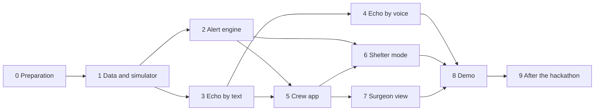

# 06 · Phased roadmap

> Spanish version: [../es/06-ruta-por-fases.md](../es/06-ruta-por-fases.md) · Concept: [05-final-concept.md](05-final-concept.md) · Screens: [07-screens.md](07-screens.md) · Architecture: [08-architecture.md](08-architecture.md)

The roadmap goes from what holds everything up (the data) to what shows in the demo (screens and voice).
- **Phases 0 to 8** make up the **hackathon MVP**.
- **Phase 9** is for later.
- Each phase ends in something that **can be tested on its own**. If time runs out, what is done already works.

## Summary

| Phase | Name | Outcome | Depends on |
|---|---|---|---|
| 0 | Preparation | Verified data, stack, repository and base design | — |
| 1 | Data and simulator | Database with a test mission; simulated sensors producing readings | 0 |
| 2 | Alert engine | Readings → 🟢🟡🔴 level → real-time alert | 1 |
| 3 | Echo by text | Chat with listen and companion modes, aware of the crew member's data | 1 (and 2 for alerts) |
| 4 | Echo by voice | Talk to and hear Echo; 🔴 alerts are spoken aloud | 3 |
| 5 | Crew app | Today, My data, Check-in, Privacy and Settings screens | 1, 2, 3 |
| 6 | Shelter mode | Replayed real solar storm, shelter with shifts and live dose | 2, 5 |
| 7 | Surgeon view | Crew panel, alerts and daily report, respecting consent | 2, 5 |
| 8 | Demo and pitch | Simulation console, bilingual polish, script, video and pitch | All |
| 9 | After the hackathon | Local model, dose map, Earth messages, wake word, expert validation | MVP |

Phases 2 and 3 can be done **in parallel** by two people, and then phases 4 and 5.

---

## Phase 0 · Preparation
- Verify the values marked ⚠️:
  - 600 mSv radiation limit.
  - Normal and concerning SpO2.
  - CO2 limit.
  - Exploration atmosphere.
  - CIMON details.
- Pick the historic solar event for the demo and download its public data (NASA DONKI / NOAA SWPC).
- Decide the final name, Echo's voice and the stack (recommendation in document 08).
- Create the repository and folder structure.
- Define colors and typography, with dark mode, since it is used aboard and at night.

**Done when:** the thresholds table has a source for every value and the repository serves an empty page.

## Phase 1 · Data and simulator
- Create the mission database (tables in document 08).
- Load test data:
  - 1 mission to Mars.
  - 4 crew members.
  - Vehicle zones, including the shelter.
  - Sensors.
  - Thresholds table.
- Build the **sensor simulator**: generates readings every few seconds (radiation, SpO2, pulse, respiration, cabin O2, pressure and CO2, sleep). It must be able to speed up time.
- Compute each crew member's **daily dose** and **accumulated dose**.
- Create the encrypted on-device store for conversations and check-ins (document 08).

**Done when:** credible readings for all 4 crew members show up in the database, and accumulated dose goes up.

## Phase 2 · Alert engine
- Compute each crew member's **baseline** per metric (mean and variation).
- Rules by threshold and by deviation from baseline → 🟢, 🟡 or 🔴 level.
- Create alerts, push them to screens in real time and record when they are acknowledged and resolved.
- Solar storm rule: a solar event creates a 🔴 shelter alert for the whole crew.

**Done when:** lowering SpO2 in the simulator produces a 🔴 alert in under 5 seconds.

## Phase 3 · Echo by text
- Echo service: receives the message and a **summary of the crew member's data** (latest state and alerts). It never receives history from the server.
- System *prompt* with:
  - Personality.
  - Listen and companion modes.
  - "Ask before advising".
  - Limits: not a therapist, does not diagnose.
  - Emergency protocol.
  - Replies in Spanish and English.
- Conversations stored **on the device only**.
- Emergency protocol: if it detects serious risk, it offers to alert someone. If the crew member agrees, a notice is sent to the surgeon **with no conversation content**.
- Test with hard cases: sadness, anger, panic, medical questions and off-topic questions.

**Done when:** Echo listens without advising, switches to companion when asked, and answers "how am I doing?" with real simulator data.

## Phase 4 · Echo by voice
- Speech to text with a microphone button, and the transcript visible on screen.
- Text to speech for replies, with a mute option.
- Switch between voice and text mid-conversation.
- 🔴 alerts are read aloud even if the crew member is in text mode.
- Works in Spanish and English.

**Done when:** a whole conversation can be held by speaking, and an alert interrupts with voice.

## Phase 5 · Crew app
Screens T1 to T9 in document 07: welcome, Today, Echo, My data, Check-in, Alert, Privacy and Settings.
- Charts for radiation (accumulated dose against the limit, and projection), SpO2, cabin, pulse and sleep.
- Privacy screen with permissions and conversation deletion.

**Done when:** a crew member can use the full app with simulated data, in both languages.

## Phase 6 · Shelter mode
- Replay the historic solar event chosen in phase 0.
- Shelter screen:
  - Countdown.
  - Assigned zone.
  - Live dose and dose avoided.
  - Estimated exit time.
  - Shelter O2 and CO2.
  - Rest shifts.
- Echo in shelter mode: explains calmly, organizes shifts and keeps the crew company.
- "All clear" summary.

**Done when:** the event is triggered from the console and the whole shelter sequence works from start to finish.

## Phase 7 · Surgeon view
Screens M1 to M5 in document 07:
- Crew panel.
- Crew member detail.
- Alerts.
- Mission radiation.
- Daily report.

Access rules:
- Safety data: always visible.
- Emotional trend: only with consent.
- Conversations: never.

**Done when:** removing consent in the crew app makes the emotional trend disappear from the surgeon panel immediately.

## Phase 8 · Demo and pitch
- Simulation console (screen D1), with buttons to:
  - Start the day.
  - Launch a solar storm.
  - Lower O2.
  - Raise CO2.
  - Change the time speed.
- Rehearse the 2-minute script from document 05.
- Review texts in both languages, dark mode and accessibility.
- Record the video, prepare the slides and write the project description with its sources.

**Done when:** the script runs 3 times in a row without failing.

## Phase 9 · After the hackathon
- Replace the cloud model with a **small local model**, with local voice too.
- Dose map by vehicle zone.
- Queued messages with Earth, showing the delay.
- "Echo" wake word to start voice.
- Review the design with psychologists and flight surgeons.
- User testing in an analog (for example, a simulated lockdown).

---

## Suggested split for a 48 h weekend ⚠️
Only a guide; it depends on team size.

| Block | Phases | Approx. hours |
|---|---|---|
| Friday night | 0 and 1 | 6 h |
| Saturday morning | 2 and 3 (in parallel) | 8 h |
| Saturday afternoon | 4 and 5 (in parallel) | 8 h |
| Saturday night | 6 | 5 h |
| Sunday morning | 7 | 5 h |
| Sunday afternoon | 8 | 6 h |
| Buffer | Bugs and surprises | 4–6 h |

**If time runs short, cut in this order:**
1. Advanced charts.
2. Daily report.
3. Mission radiation view.

**Never cut:** Echo by voice, the 🔴 alert and shelter mode, because they are the heart of the demo.
