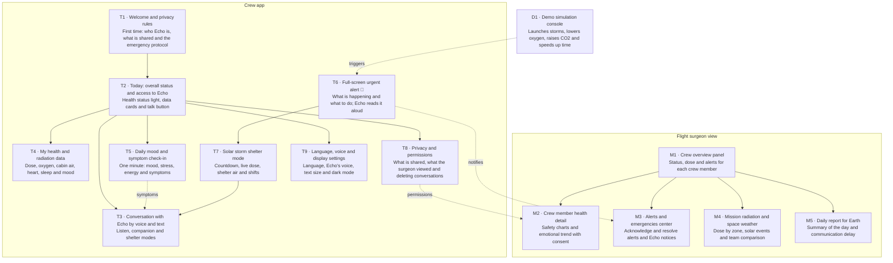

# 07 · Screens

> Spanish version: [../es/07-pantallas.md](../es/07-pantallas.md) · Roadmap: [06-roadmap.md](06-roadmap.md) · Data: [08-architecture.md](08-architecture.md)

This document **describes** the screens. There are no mockups or code yet.
There are three groups:
- **T:** crew app.
- **M:** flight surgeon view.
- **D:** demo console.

Rules for every screen:
- They work in Spanish and English.
- They have dark mode.
- They have large text and easy-to-tap buttons, because aiming precisely is hard in microgravity ⚠️.
- **A 🔴 alert appears on top of any screen.**

## Navigation map

**Short names:** the text uses short names (Today, Echo, My data, Check-in, Alert, Shelter, Privacy, Settings; Panel, Detail, Alerts, Radiation, Report; Console).

---

## Crew app

### T1 · Welcome and privacy rules
- **Purpose:** introduce Echo and explain the rules before it is used.
- **Content:**
  1. Choose crew member (in the demo) and language.
  2. Who Echo is: "I'm here to listen; I'm not a therapist".
  3. **The three privacy rules:** safety data is always shared, mood only with consent, and conversations never.
  4. **Emergency protocol**, explained clearly.
  5. Choose Echo's voice and whether it should reply out loud.
  6. Initial permissions (all off by default, except safety ones).
- **Final action:** "Start". A record is kept that the crew member accepted the rules.

### T2 · Today: overall status and access to Echo
- **Purpose:** see at a glance how the crew member is doing, and talk to Echo.
- **Content:**
  - Greeting and overall 🟢🟡🔴 status.
  - **Big "Talk to Echo" button**, with microphone and keyboard.
  - Summary cards:
    - Today's dose and accumulated dose against the limit.
    - SpO2.
    - Cabin air (O2 and CO2).
    - Pulse.
    - Last night's sleep.
  - Check-in reminder if today's is missing.
  - Pending 🟡 notices.
- **States:**
  - No data yet: "waiting for sensors".
  - Sensor disconnected: the card turns gray with a notice.

### T3 · Conversation with Echo by voice and text
- **Purpose:** talk or type with Echo.
- **Content:**
  - Conversation bubbles.
  - Current mode indicator: **Listen** or **Companion**, which can be changed.
  - Microphone button, with listening or processing state, and live transcript.
  - Text field.
  - Button to mute Echo's voice.
  - Indicator "🔒 this conversation is only stored on your device".
- **Actions:**
  - Switch between voice and text mid-conversation.
  - Ask "how am I doing?" (Echo answers with the data).
  - Delete the conversation.
- **States:**
  - Echo thinking.
  - No connection to the service: notice and option to write in the journal.
  - No microphone permission: switches to text.
- **In shelter mode:** shows a header with the countdown or time left.

### T4 · My health and radiation data
- **Purpose:** see trends in one's own data.
- **Sections (tabs):**
  1. **Radiation:**
     - Daily dose (bars).
     - Accumulated dose against the career limit (progress bar).
     - End-of-mission projection.
     - GCR, SPE and neutron breakdown.
     - Clear, non-alarming message.
  2. **Oxygen:** SpO2 and cabin O2 and pressure, with baseline.
  3. **Air:** cabin CO2.
  4. **Heart and breathing:** pulse and respiratory rate.
  5. **Sleep:** hours and interruptions per night.
  6. **Mood:** check-in trend. It is private and only the crew member sees it.
- **Filters:** 24 h, 7 days, 30 days and whole mission.

### T5 · Daily mood and symptom check-in
- **Purpose:** record in 1 minute how the crew member feels.
- **Content:**
  - Mood, stress and energy on a 1–5 scale, with faces.
  - Checkable symptoms: headache, confusion, vision, dizziness and other.
  - Optional note.
  - It can also be done by talking to Echo.
- **Afterwards:** Echo says thanks and, if there are hypoxia symptoms, checks SpO2 and alerts if needed.

### T6 · Full-screen urgent alert 🔴
- **Purpose:** warn about something that cannot wait.
- **Content:** full screen with:
  - Clear color.
  - Simple title: e.g. "Solar storm: go to the shelter" or "Low oxygen".
  - What to do in 1 to 3 steps.
  - "Got it" button.
- **Behavior:**
  - Appears on top of any screen.
  - Echo **reads it aloud** even in text mode or when muted.
  - The surgeon is notified automatically.

### T7 · Solar storm shelter mode
- **Purpose:** keep the crew company during a solar storm.
- **Content:**
  - Countdown to arrival and assigned zone.
  - Inside the shelter:
    - Live dose.
    - Dose avoided.
    - Estimated exit time.
    - Shelter O2 and CO2.
  - Crew rest shifts.
  - "Talk to Echo" button, which opens T3 in shelter mode.
- **End:** "All clear" screen, with a summary of duration and dose avoided.

### T8 · Privacy and permissions
- **Purpose:** let the crew member control what is shared.
- **Content:**
  - The three rules, explained again.
  - Switches for each permission:
    - Mood trend to the surgeon.
    - Sleep trend to the surgeon.
    - Let Echo remember past conversations.
  - List of **what the surgeon viewed and when**.
  - "Delete all my conversations" (with confirmation) and "Delete what Echo remembers" buttons.
- **Rule:** when a permission is removed, that data disappears from the surgeon view immediately.

### T9 · Language, voice and display settings
- Language.
- Echo's voice.
- Spoken replies (yes or no).
- Voice speed.
- Text size.
- Dark mode.
- Headphone use.

---

## Flight surgeon view

### M1 · Crew overview panel
- **Purpose:** see the whole crew at a glance.
- **Content:** one card per crew member with:
  - 🟢🟡🔴 status.
  - Accumulated dose against the limit.
  - SpO2.
  - Last alert.
  - Mood and sleep trend **only with consent**. Otherwise: "🔒 not shared".
- Header with cabin status (O2, CO2 and pressure) and space weather.

### M2 · Crew member health detail
- Charts of safety data, with the same tabs as T4 except "Mood".
- Emotional trend only with consent.
- That person's alert history.
- **Never shows conversations.**

### M3 · Alerts and emergencies center
- List of alerts with level, crew member, metric and time.
- Filters by level and status: active, acknowledged or resolved.
- "Acknowledge" and "Resolve" buttons, with a note.
- Echo emergency notices, which **only state the category** (e.g. "serious emotional risk") and the time.

### M4 · Mission radiation and space weather
- Dose by vehicle zone.
- Past and active solar events.
- Accumulated dose for all crew members, compared.
- Later: vehicle dose map.

### M5 · Daily report for Earth
- Summary of the day to send to Earth: alerts, dose, cabin status and consented trends.
- "Mark as sent" button.
- Current communication delay indicator.

---

## Demo console

### D1 · Demo simulation console
- **For the presentation only.** It would not exist on a real mission.
- **Controls:**
  - Time speed (1×, 10×, 60×).
  - Choose crew member.
  - "Launch solar storm", which replays the historic event.
  - "Lower cabin O2".
  - "Lower a crew member's SpO2".
  - "Raise CO2".
  - "Bad night of sleep".
  - "Reset demo".
- Shows the readings being generated, live.

---

## Screens by phase

| Phase | Screens |
|---|---|
| 3 and 4 | T3 |
| 5 | T1, T2, T4, T5, T6, T8, T9 |
| 6 | T7 |
| 7 | M1, M2, M3, M4, M5 |
| 8 | D1 |
