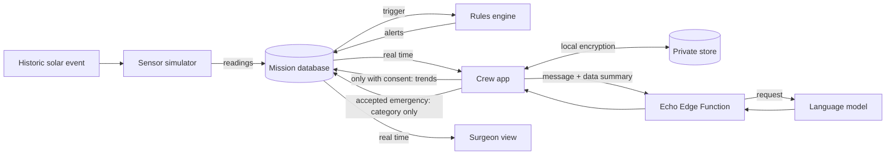
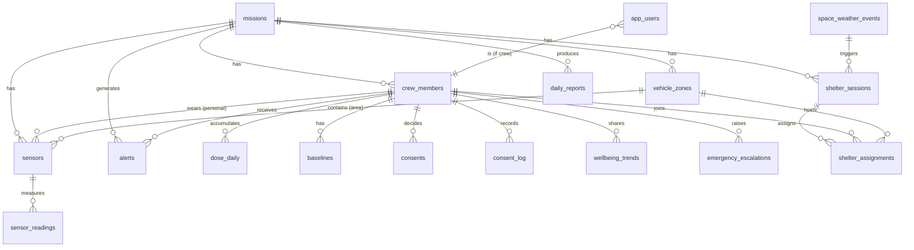

# 08 · Architecture and database

> Spanish version: [../es/08-arquitectura.md](../es/08-arquitectura.md) · Roadmap: [06-roadmap.md](06-roadmap.md) · Screens: [07-screens.md](07-screens.md)

This document is design only; there is no code or SQL yet. The schema is built in **phase 1**.

## 1. Core idea: two separate stores
Privacy does not rely on someone "promising" not to look: **it is built into the structure**.

| Store | Where it lives | What it holds | Who sees it |
|---|---|---|---|
| **Mission database** | Vehicle server (in the demo, the cloud) | Sensors, dose, alerts, shelter, consents, shared trends and reports | The crew member (their own) and the surgeon (safety data, plus what they have consent for) |
| **Private device store** | The crew member's personal device, encrypted | Conversations with Echo, journal, full check-ins and what Echo remembers | **Only the crew member** |

Conversations **do not exist** in the mission database. So the surgeon cannot see them even if they wanted to.

---

## 2. Recommended hackathon stack

| Piece | Choice | Why |
|---|---|---|
| Frontend | Plain HTML, CSS and JavaScript (or React if the team prefers) | Quick to set up, no build step |
| Mission database | **Supabase** (Postgres, Realtime, Auth and Edge Functions) | Real time for alerts, access rules (RLS), and you already know it |
| Private store | Browser **IndexedDB**, encrypted with Web Crypto (AES‑GCM) | Stays on the device |
| Echo (language) | Cloud model (e.g. the Claude API), called from an **Edge Function** | The API key never reaches the browser |
| Voice | Browser Web Speech API (speech to text and text to speech) ⚠️ | Free and enough for the demo |
| Simulator | Node script or the D1 console with a special "simulator" role | Generates credible readings and speeds up time |
| Space weather | JSON file with the historic event downloaded from NASA DONKI or NOAA SWPC ⚠️ | The demo doesn't depend on internet |

**On a real vehicle (phase 9):**
- The mission database would run on an onboard server.
- Echo would use a small local model, with speech to text and text to speech also local.
- It would not depend on internet.

---

## 3. Components and data flow

### Flow 1 · Reading → alert
1. The simulator inserts a reading into `sensor_readings`.
2. A database trigger compares it with `thresholds` and `baselines`.
3. If the result is 🟡 or 🔴, a row is created in `alerts`.
4. Realtime pushes it to the crew app and the surgeon view.
5. If it is 🔴, the app shows T6 and Echo reads it aloud.

### Flow 2 · Conversation with Echo
1. The crew member speaks or types. Voice is turned into text in the browser.
2. The app builds a **short data summary**: current state, latest alerts and dose. It adds the last messages of the conversation, which come from the local store.
3. The Edge Function receives the message, the summary, the mode (listen, companion or shelter) and the language. It adds the system *prompt* and calls the model.
4. The reply comes back to the app, is saved **only in the local store** and is read aloud if enabled.
5. **The Edge Function stores nothing** and does not log content.
   - In the demo, the message does pass through the cloud model; this is explained in the pitch.
   - On the real vehicle everything would be local.

### Flow 3 · Consented trends
- The device computes a daily mood and sleep average from local check-ins.
- If consent exists in `consents`, it uploads **only that average** to `wellbeing_trends`. It never uploads notes or conversations.
- If consent is withdrawn, the rows already shared are deleted and uploads stop.

### Flow 4 · Emergency protocol
- Echo detects serious risk and offers to alert someone.
- If the crew member accepts, a row is created in `emergency_escalations` with **only the category and time**.
- The surgeon sees it in M3.

### Flow 5 · Solar storm
1. The D1 console replays the event and a row is created in `space_weather_events`.
2. A rule creates a 🔴 alert for the whole crew and opens a `shelter_sessions` row.
3. Zones and shifts are assigned in `shelter_assignments`.
4. Live dose is computed from the shelter zone's readings.
5. At the end, the estimated dose avoided is saved.

---

## 4. Mission database (Postgres)

> **Update:** the final design, reviewed screen by screen, is in [09-database-diagram.md](09-database-diagram.md). It adds 8 tables and 3 views, and moves shelter shifts to the `shelter_shifts` table. Where this section disagrees, **document 09 wins**.

### Types (enums)
- `user_role`: `crew`, `surgeon`, `simulator`, `admin`
- `metric`:
  - Radiation: `dose_rate_usv_h`, `neutron_dose_rate_usv_h`
  - Crew vitals: `spo2_pct`, `heart_rate_bpm`, `resp_rate_bpm`, `sleep_minutes`, `sleep_interruptions`
  - Cabin: `cabin_o2_pct`, `cabin_pressure_psia`, `cabin_co2_mmhg`, `cabin_temp_c`
- `alert_level`: `normal`, `attention`, `urgent`
- `alert_status`: `active`, `acknowledged`, `resolved`
- `consent_scope`: `mood_trend`, `sleep_trend`
- `sensor_kind`: `wearable`, `personal_dosimeter`, `area_dosimeter`, `cabin_env`
- `escalation_category`: `self_harm_risk`, `acute_panic`, `other_serious`

### Tables

**Mission and people**

| Table | Main columns | Notes |
|---|---|---|
| `missions` | `id`, `name`, `destination`, `start_date`, `end_date_planned`, `comm_delay_s` | `comm_delay_s` feeds the delay indicator |
| `crew_members` | `id`, `mission_id`, `display_name`, `role_title`, `language` (`es`/`en`), `prior_career_dose_msv`, `career_limit_msv` (600 default ⚠️) | Dose from previous missions, for career risk |
| `app_users` | `id` (= Auth user), `role` (`user_role`), `crew_member_id` (null if not crew), `mission_id` | Links the account to the person and their role |
| `rules_acceptance` | `crew_member_id`, `accepted_at`, `rules_version` | Record that the rules were accepted in T1 |

**Vehicle and sensors**

| Table | Main columns | Notes |
|---|---|---|
| `vehicle_zones` | `id`, `mission_id`, `name`, `shielding_factor`, `is_shelter`, `capacity` | The shelter is a zone with `is_shelter = true` |
| `sensors` | `id`, `mission_id`, `kind` (`sensor_kind`), `zone_id` (null if personal), `crew_member_id` (null if area), `active` | Personal or area |
| `sensor_readings` | `id`, `sensor_id`, `crew_member_id` (null for cabin), `zone_id`, `metric`, `value`, `recorded_at` | Large time-series table. Indexes on (`crew_member_id`, `metric`, `recorded_at`) and (`zone_id`, `metric`, `recorded_at`) |

**Radiation**

| Table | Main columns | Notes |
|---|---|---|
| `dose_daily` | `crew_member_id`, `day`, `total_msv`, `gcr_msv`, `spe_msv`, `neutron_msv` | Key (`crew_member_id`, `day`). Recomputed with each dose reading |
| View `dose_career` | `crew_member_id`, `mission_dose_msv`, `career_dose_msv`, `career_limit_msv`, `pct_of_limit`, `projected_end_msv` | Computed from `dose_daily` and `crew_members` |
| `space_weather_events` | `id`, `source` (DONKI/SWPC), `external_id`, `event_type`, `s_scale`, `starts_at`, `peak_at`, `ends_at`, `raw` (json) | The demo's historic event |
| `shelter_sessions` | `id`, `mission_id`, `event_id`, `zone_id`, `started_at`, `ended_at`, `dose_avoided_est_msv` | One per storm |
| `shelter_assignments` | `session_id`, `crew_member_id`, `zone_id`, `rest_shift_start`, `rest_shift_end`, `arrived_at` | Each person's zone and shifts |

**Rules and alerts**

| Table | Main columns | Notes |
|---|---|---|
| `thresholds` | `metric`, `level`, `min_value`, `max_value`, `source_url`, `verified` | A value marked ⚠️ stays `verified = false` until checked in phase 0 |
| `baselines` | `crew_member_id`, `metric`, `mean`, `stddev`, `samples`, `updated_at` | Personal baseline |
| `alerts` | `id`, `mission_id`, `crew_member_id` (null if vehicle-wide), `level`, `status`, `kind` (e.g. `solar_storm`, `low_spo2`, `high_co2`), `metric`, `value`, `message_es`, `message_en`, `created_at`, `acknowledged_at`, `acknowledged_by`, `resolved_at`, `note` | Message in both languages |

**Privacy and surgeon**

| Table | Main columns | Notes |
|---|---|---|
| `consents` | `crew_member_id`, `scope` (`consent_scope`), `granted`, `updated_at` | Key (`crew_member_id`, `scope`) |
| `consent_log` | `id`, `crew_member_id`, `scope`, `granted`, `changed_at` | Change history, never deleted |
| `wellbeing_trends` | `crew_member_id`, `day`, `mood_avg`, `stress_avg`, `sleep_quality_avg` | **Only** daily averages, and only with consent |
| `surgeon_access_log` | `id`, `surgeon_user_id`, `crew_member_id`, `resource`, `viewed_at` | Feeds "what the surgeon viewed and when" in T8 |
| `emergency_escalations` | `id`, `crew_member_id`, `category`, `created_at`, `acknowledged_at`, `acknowledged_by` | **No** conversation text |
| `daily_reports` | `id`, `mission_id`, `day`, `summary` (json), `created_at`, `sent_to_earth_at` | M5 report |

### Relationships

### Access rules (RLS)

| Table | Crew member | Surgeon | Simulator |
|---|---|---|---|
| `sensor_readings`, `dose_daily`, `baselines` | Reads own and cabin | Reads all | Inserts |
| `alerts` | Reads own and vehicle-wide; acknowledges | Reads all; acknowledges and resolves | Inserts (via rules) |
| `consents`, `consent_log` | Reads and changes **only** own | Reads | — |
| `wellbeing_trends` | Inserts and deletes own | Reads **only if** that crew member's consent is active (policy joins `consents`) | — |
| `emergency_escalations` | Inserts own | Reads and acknowledges | — |
| `surgeon_access_log` | Reads what was viewed about them | Inserts (automatic on view) | — |
| `daily_reports` | — | Creates and marks as sent | — |
| `missions`, `vehicle_zones`, `thresholds` | Reads | Reads | Reads |

**Extra safeguards:**
- When consent is removed, a trigger on `consents` deletes the rows already shared in `wellbeing_trends`.
- No table has free-text columns from the crew member, except the surgeon's `note` in `alerts`.
- The simulator's service key exists only in the demo console, never in the crew app.

### Performance
- `sensor_readings` grows fast: in the demo, readings older than 7 simulated days should be **purged or aggregated** into hourly averages.
- Realtime only subscribes to `alerts`, `shelter_sessions` and the current crew member's readings.

---

## 5. Private device store (IndexedDB, encrypted)

| Store | Fields | Notes |
|---|---|---|
| `conversations` | `id`, `started_at`, `mode` (listen/companion/shelter), `language` | |
| `messages` | `id`, `conversation_id`, `role` (crew/echo), `text`, `input` (voice/text), `created_at` | Voice is stored only as transcribed text, not audio |
| `journal_entries` | `id`, `text`, `created_at` | Private journal |
| `checkins` | `id`, `day`, `mood`, `stress`, `energy`, `symptoms[]`, `note`, `created_at` | Notes never leave the device |
| `memory_facts` | `id`, `fact`, `source_conversation_id`, `created_at` | What Echo remembers; exists only if the crew member consented in T8 |
| `settings` | `language`, `voice`, `speak_replies`, `voice_rate`, `text_size`, `theme` | |

**Encryption:**
- One key per crew member, derived from their local PIN or password (PBKDF2 → AES‑GCM).
- If the key is deleted, the whole store becomes unreadable.

**Deletion:** the T8 buttons remove `conversations`, `messages` and `memory_facts`.

---

## 6. Security and privacy (summary)
- The model API key lives only in the Edge Function.
- The Edge Function does not log messages: no content logs and nothing stored.
- Conversations exist only on the device, encrypted.
- The surgeon always sees safety data; emotional data only with consent, and every view is logged.
- The emergency protocol shares only the category and time.
- **Demo notice:** "On the real mission, Echo works without leaving the vehicle."

## 7. Open decisions
- Plain HTML and JS, or React?
- Local PIN for encryption, or a password?
- Which historic solar event to replay?
