# 09 · Database diagram derived from the screens

> Spanish version: [../es/09-diagrama-bd.md](../es/09-diagrama-bd.md) · Screens: [07-screens.md](07-screens.md) · Architecture: [08-architecture.md](08-architecture.md)

I went through the 15 screens one by one and noted what data each one reads and what data it writes. With that:
- The design in document 08 was completed.
- The missing tables were added.
- The **final diagram** is ready for creating the database in phase 1.

> **Implemented:** the SQL is in [supabase/schema.sql](../../supabase/schema.sql) and the test data in [supabase/seed_demo.sql](../../supabase/seed_demo.sql). Writing it added three columns:
> - `alerts.zone_id`: cabin alerts need to know their zone.
> - `alert_types.metric`: links each metric to its alert type.
> - `space_weather_events.mission_id`: the mission replaying the event.
>
> Functions (RPC) were also added so the app never edits tables directly: `acknowledge_alert`, `mark_alert_spoken`, `mark_shelter_arrival`, `set_my_language`, `resolve_alert` and `close_shelter_session`. Physical symptoms are **always shared with the surgeon, without notes**.

Reminder of the main rule:
- **Conversations, journal, notes and personal settings** live in the **private device store**, not in this database.
- This is the **mission database** (Postgres on Supabase).

---

## 1. What each screen needs

| Screen | Reads | Writes | Private store |
|---|---|---|---|
| **T1** Welcome and privacy rules | `crew_members`, `missions` | `rules_acceptance`, `consents`, `consent_log` | `settings` (voice and language) |
| **T2** Today: overall status and access to Echo | Views `crew_status`, `latest_readings`, `cabin_status`, `dose_career`; active 🟡 `alerts`; `sensors.last_seen_at` | — | `checkins` (is today's missing?) |
| **T3** Conversation with Echo | Views `latest_readings`, `dose_career`; active `alerts`; active `shelter_sessions` | `emergency_escalations` (only if the crew member agrees) | `conversations`, `messages`, `memory_facts` |
| **T4** My health and radiation data | `sensor_readings` (24 h), `sensor_readings_hourly` (7 days, 30 days and mission), `baselines`, `dose_daily`, view `dose_career`, `thresholds` | — | `checkins` (Mood tab) |
| **T5** Daily check-in | — | `symptom_reports` (physical symptoms only, no note) and `wellbeing_trends` (daily average, only with consent) | Full `checkins`, with note |
| **T6** Urgent alert 🔴 | `alerts`, `alert_types` (title and steps in both languages) | `alert_acknowledgements`, `alerts.spoken_at` | — |
| **T7** Shelter mode | `shelter_sessions`, `shelter_assignments`, `shelter_shifts`, `vehicle_zones`, shelter `sensor_readings`, `space_weather_events` | `shelter_assignments.arrived_at` | — |
| **T8** Privacy and permissions | `consents`, `consent_log`, `surgeon_access_log` | `consents`, `consent_log`; deleting `wellbeing_trends` | Deleting `conversations`, `messages` and `memory_facts` |
| **T9** Settings | — | `crew_members.language` (for alert messages) | `settings` |
| **M1** Crew overview panel | Views `crew_status`, `dose_career`, `cabin_status`; `wellbeing_trends` (with consent); active `space_weather_events` | `surgeon_access_log` | — |
| **M2** Crew member health detail | `sensor_readings`, `sensor_readings_hourly`, `baselines`, `dose_daily`, `alerts`, `symptom_reports`, `wellbeing_trends` (with consent) | `surgeon_access_log` | — |
| **M3** Alerts and emergencies center | `alerts`, `alert_types`, `alert_acknowledgements`, `emergency_escalations` | `alerts` (acknowledge, resolve and note), `emergency_escalations` (acknowledge) | — |
| **M4** Mission radiation and space weather | `zone_dose_daily`, `vehicle_zones`, `space_weather_events`, view `dose_career` | — | — |
| **M5** Daily report for Earth | All of the above, summarized; `missions.comm_delay_s` | `daily_reports` | — |
| **D1** Demo simulation console | `simulation_state`, `crew_members`, `sensors` | `simulation_state`, `simulation_events`, `sensor_readings`, `space_weather_events` | — |

---

## 2. What changed from document 08

| Change | Why (screen) |
|---|---|
| **New:** `alert_types` | T6 needs a title and 1 to 3 steps per alert type, in both languages |
| **New:** `alert_acknowledgements` | A vehicle-wide alert is acknowledged by **each** crew member separately (T6), plus the surgeon (M3) |
| **New:** `shelter_shifts` | T7 shows several shifts per person; replaces the shift columns in `shelter_assignments` |
| **New:** `symptom_reports` | T5 and M2: physical hypoxia symptoms are safety data. ⚠️ Your decision: always shared, or only with consent? |
| **New:** `sensor_readings_hourly` | T4 and M2 show 30 days and the whole mission; reading every row would be too slow |
| **New:** `zone_dose_daily` | M4 shows dose by vehicle zone |
| **New:** `simulation_state`, `simulation_events` | D1 controls the simulated clock, speed and demo reset |
| **New views:** `latest_readings`, `crew_status`, `cabin_status` | T2 and M1 show "the latest" and the status light without computing in the browser |
| **New columns:** `sensors.last_seen_at`, `alerts.alert_type_id`, `alerts.resolved_by`, `alerts.spoken_at`, `alerts.shelter_session_id`, `shelter_sessions.expected_end_at`, `emergency_escalations.resolved_at`, `crew_members.avatar_color` | "Sensor disconnected" state (T2), alert steps (T6), exit time (T7) and visual identification (M1) |

---

## 3. Full diagram

Types: `uuid`, `text`, `int`, `numeric`, `bool`, `date`, `timestamptz`, `jsonb`. Enums are detailed in section 5.
Marks: **PK** = primary key, **FK** = foreign key, **UK** = unique.

```mermaid
erDiagram
  missions {
    uuid id PK
    text name
    text destination
    date start_date
    date end_date_planned
    int comm_delay_s
    timestamptz created_at
  }
  crew_members {
    uuid id PK
    uuid mission_id FK
    text display_name
    text role_title
    text language
    text avatar_color
    numeric prior_career_dose_msv
    numeric career_limit_msv
    timestamptz created_at
  }
  app_users {
    uuid id PK "Auth user"
    user_role role
    uuid mission_id FK
    uuid crew_member_id FK "null if not crew"
    text display_name
  }
  rules_acceptance {
    uuid crew_member_id PK,FK
    text rules_version PK
    timestamptz accepted_at
  }
  vehicle_zones {
    uuid id PK
    uuid mission_id FK
    text name
    numeric shielding_factor
    bool is_shelter
    int capacity
  }
  sensors {
    uuid id PK
    uuid mission_id FK
    sensor_kind kind
    uuid zone_id FK "null if personal"
    uuid crew_member_id FK "null if area"
    bool active
    timestamptz last_seen_at
  }
  sensor_readings {
    bigint id PK
    uuid sensor_id FK
    uuid crew_member_id FK "null for cabin"
    uuid zone_id FK
    metric metric
    numeric value
    timestamptz recorded_at "simulated time"
  }
  sensor_readings_hourly {
    uuid sensor_id PK,FK
    metric metric PK
    timestamptz hour PK
    uuid crew_member_id FK
    uuid zone_id FK
    numeric avg_value
    numeric min_value
    numeric max_value
    int samples
  }
  baselines {
    uuid crew_member_id PK,FK
    metric metric PK
    numeric mean
    numeric stddev
    int samples
    timestamptz updated_at
  }
  thresholds {
    metric metric PK
    alert_level level PK
    numeric min_value
    numeric max_value
    text source_url
    bool verified
  }
  dose_daily {
    uuid crew_member_id PK,FK
    date day PK
    numeric total_msv
    numeric gcr_msv
    numeric spe_msv
    numeric neutron_msv
  }
  zone_dose_daily {
    uuid zone_id PK,FK
    date day PK
    numeric total_msv
    numeric neutron_msv
  }
  alert_types {
    text code PK "low_spo2, high_co2, solar_storm..."
    alert_level default_level
    text title_es
    text title_en
    jsonb steps_es
    jsonb steps_en
  }
  alerts {
    uuid id PK
    uuid mission_id FK
    uuid crew_member_id FK "null if vehicle-wide"
    text alert_type_id FK
    uuid shelter_session_id FK
    alert_level level
    alert_status status
    metric metric
    numeric value
    text message_es
    text message_en
    timestamptz created_at
    timestamptz spoken_at
    timestamptz acknowledged_at
    uuid acknowledged_by FK
    timestamptz resolved_at
    uuid resolved_by FK
    text note "surgeon only"
  }
  alert_acknowledgements {
    uuid alert_id PK,FK
    uuid user_id PK,FK
    timestamptz acknowledged_at
  }
  symptom_reports {
    uuid id PK
    uuid crew_member_id FK
    symptom symptom
    timestamptz reported_at
  }
  emergency_escalations {
    uuid id PK
    uuid crew_member_id FK
    escalation_category category
    timestamptz created_at
    timestamptz acknowledged_at
    uuid acknowledged_by FK
    timestamptz resolved_at
  }
  space_weather_events {
    uuid id PK
    text source
    text external_id UK
    text event_type
    int s_scale
    timestamptz starts_at
    timestamptz peak_at
    timestamptz ends_at
    jsonb raw
  }
  shelter_sessions {
    uuid id PK
    uuid mission_id FK
    uuid event_id FK
    uuid zone_id FK
    timestamptz started_at
    timestamptz expected_end_at
    timestamptz ended_at
    numeric dose_avoided_est_msv
  }
  shelter_assignments {
    uuid session_id PK,FK
    uuid crew_member_id PK,FK
    uuid zone_id FK
    timestamptz arrived_at
  }
  shelter_shifts {
    uuid id PK
    uuid session_id FK
    uuid crew_member_id FK
    shift_kind kind
    timestamptz starts_at
    timestamptz ends_at
  }
  consents {
    uuid crew_member_id PK,FK
    consent_scope scope PK
    bool granted
    timestamptz updated_at
  }
  consent_log {
    uuid id PK
    uuid crew_member_id FK
    consent_scope scope
    bool granted
    timestamptz changed_at
  }
  wellbeing_trends {
    uuid crew_member_id PK,FK
    date day PK
    numeric mood_avg
    numeric stress_avg
    numeric energy_avg
    numeric sleep_quality_avg
  }
  surgeon_access_log {
    uuid id PK
    uuid surgeon_user_id FK
    uuid crew_member_id FK
    text resource
    timestamptz viewed_at
  }
  daily_reports {
    uuid id PK
    uuid mission_id FK
    date day UK
    jsonb summary
    uuid created_by FK
    timestamptz created_at
    timestamptz sent_to_earth_at
  }
  simulation_state {
    uuid mission_id PK,FK
    timestamptz sim_clock
    int time_speed
    bool running
    timestamptz updated_at
  }
  simulation_events {
    uuid id PK
    uuid mission_id FK
    text kind "solar_storm, lower_o2, raise_co2..."
    jsonb params
    uuid triggered_by FK
    timestamptz triggered_at
  }

  missions ||--o{ crew_members : has
  missions ||--o{ app_users : groups
  missions ||--o{ vehicle_zones : has
  missions ||--o{ sensors : has
  missions ||--o{ alerts : generates
  missions ||--o{ shelter_sessions : has
  missions ||--o{ daily_reports : produces
  missions ||--|| simulation_state : controls
  missions ||--o{ simulation_events : records
  crew_members |o--o| app_users : "signs in as"
  crew_members ||--o{ rules_acceptance : accepts
  crew_members ||--o{ sensors : "wears (personal)"
  vehicle_zones ||--o{ sensors : "contains (area)"
  sensors ||--o{ sensor_readings : measures
  sensors ||--o{ sensor_readings_hourly : summarizes
  crew_members ||--o{ baselines : has
  crew_members ||--o{ dose_daily : accumulates
  vehicle_zones ||--o{ zone_dose_daily : accumulates
  alert_types ||--o{ alerts : defines
  crew_members ||--o{ alerts : receives
  alerts ||--o{ alert_acknowledgements : "acknowledged by"
  app_users ||--o{ alert_acknowledgements : acknowledges
  crew_members ||--o{ symptom_reports : reports
  crew_members ||--o{ emergency_escalations : raises
  space_weather_events ||--o{ shelter_sessions : triggers
  shelter_sessions ||--o{ alerts : originates
  vehicle_zones ||--o{ shelter_sessions : "serves as shelter"
  shelter_sessions ||--o{ shelter_assignments : assigns
  crew_members ||--o{ shelter_assignments : joins
  shelter_sessions ||--o{ shelter_shifts : organizes
  crew_members ||--o{ shelter_shifts : covers
  crew_members ||--o{ consents : decides
  crew_members ||--o{ consent_log : records
  crew_members ||--o{ wellbeing_trends : shares
  crew_members ||--o{ surgeon_access_log : "is viewed"
  app_users ||--o{ surgeon_access_log : views
  app_users ||--o{ daily_reports : creates
  app_users ||--o{ simulation_events : triggers
```

---

## 4. Views

| View | Columns | Used by |
|---|---|---|
| `latest_readings` | `crew_member_id`, `zone_id`, `metric`, `value`, `recorded_at`, `level` (compared with `thresholds`) | T2, T3, M1 |
| `crew_status` | `crew_member_id`, `display_name`, `overall_level` (worst level among active alerts), `active_alerts`, `last_reading_at` | T2, M1 |
| `cabin_status` | `zone_id`, `cabin_o2_pct`, `cabin_pressure_psia`, `cabin_co2_mmhg`, `cabin_temp_c`, `level` | T2, M1, T7 |
| `dose_career` | `crew_member_id`, `mission_dose_msv`, `career_dose_msv`, `career_limit_msv`, `pct_of_limit`, `projected_end_msv` | T2, T4, M1, M4 |

---

## 5. Enums

| Enum | Values |
|---|---|
| `user_role` | `crew`, `surgeon`, `simulator`, `admin` |
| `sensor_kind` | `wearable`, `personal_dosimeter`, `area_dosimeter`, `cabin_env` |
| `metric` | `dose_rate_usv_h`, `neutron_dose_rate_usv_h`, `spo2_pct`, `heart_rate_bpm`, `resp_rate_bpm`, `sleep_minutes`, `sleep_interruptions`, `cabin_o2_pct`, `cabin_pressure_psia`, `cabin_co2_mmhg`, `cabin_temp_c` |
| `alert_level` | `normal`, `attention`, `urgent` |
| `alert_status` | `active`, `acknowledged`, `resolved` |
| `symptom` | `headache`, `confusion`, `vision`, `dizziness`, `shortness_of_breath`, `other` |
| `escalation_category` | `self_harm_risk`, `acute_panic`, `other_serious` |
| `consent_scope` | `mood_trend`, `sleep_trend` |
| `shift_kind` | `rest`, `watch` |

---

## 6. Triggers (logic inside the database)

| Trigger | On | What it does |
|---|---|---|
| `evaluate_reading` | Insert into `sensor_readings` | Updates `sensors.last_seen_at`. Compares the reading with `thresholds` and `baselines` and, if the result is 🟡 or 🔴, creates a row in `alerts` (without duplicating one that is still active). If it is a dose reading, adds it to `dose_daily` and `zone_dose_daily`. |
| `start_shelter` | Insert into `space_weather_events` with a high `s_scale` | Creates `shelter_sessions`, a vehicle-wide 🔴 alert and one `shelter_assignments` row per crew member. |
| `clear_trends` | `consents` changed to `granted = false` | Deletes that crew member's `wellbeing_trends` rows and writes to `consent_log`. |
| `log_consent` | Insert or update on `consents` | Writes to `consent_log`. |
| `aggregate_hourly` | Periodic job (or when the simulated clock advances) | Summarizes `sensor_readings` into `sensor_readings_hourly` and deletes readings older than 7 simulated days. |
| `refresh_baseline` | Periodic job | Recomputes `baselines` from the last few days. |

---

## 7. Order for creating the database (phase 1)
1. **Enums** (section 5).
2. **Catalogs:** `missions`, `alert_types`, `thresholds`.
3. **People:** `crew_members`, `app_users`, `rules_acceptance`.
4. **Vehicle:** `vehicle_zones`, `sensors`.
5. **Data:** `sensor_readings`, `sensor_readings_hourly`, `baselines`, `dose_daily`, `zone_dose_daily`.
6. **Space weather and shelter:** `space_weather_events`, `shelter_sessions`, `shelter_assignments`, `shelter_shifts`.
7. **Alerts:** `alerts`, `alert_acknowledgements`, `symptom_reports`, `emergency_escalations`.
8. **Privacy:** `consents`, `consent_log`, `wellbeing_trends`, `surgeon_access_log`.
9. **Reports and demo:** `daily_reports`, `simulation_state`, `simulation_events`.
10. **Views** (section 4).
11. **Triggers** (section 6).
12. **Access rules (RLS):** see the table in document 08, plus these for the new tables:
    - `alert_acknowledgements`: each user inserts their own and the surgeon reads all.
    - `symptom_reports`: the crew member inserts and reads their own; the surgeon reads all, or only with consent depending on your decision.
    - `simulation_state` and `simulation_events`: `simulator` role only.
    - `zone_dose_daily` and `alert_types`: everyone reads.
13. **Test data:** 1 mission, 4 crew members, 1 surgeon, zones (including the shelter), sensors, alert types and thresholds with their source.

**Total:** 28 tables, 4 views, 9 enums and 6 triggers.

---

## 8. Decisions before creating it
- **Physical symptoms (`symptom_reports`):** always shared with the surgeon, like safety data, or only with consent? My recommendation is always, but without the note.
- **Simulated clock:** all timestamps (`recorded_at`, etc.) use the simulated time from `simulation_state.sim_clock`. That way the demo can advance days in minutes.
- **Identifiers:** `uuid` everywhere, except `sensor_readings`, which uses `bigint` because it is the largest table.
