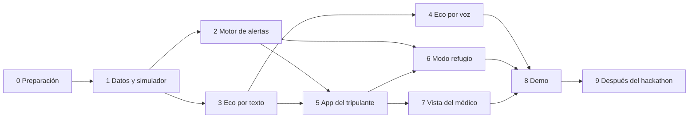

# 06 · Ruta por fases

> Versión en inglés: [../en/06-roadmap.md](../en/06-roadmap.md) · Concepto: [05-concepto-final.md](05-concepto-final.md) · Pantallas: [07-pantallas.md](07-pantallas.md) · Arquitectura: [08-arquitectura.md](08-arquitectura.md)

La ruta va de lo que sostiene todo (los datos) a lo que se ve en la demo (pantallas y voz).
- Las **fases 0 a 8** forman el **MVP del hackathon**.
- La **fase 9** queda para después.
- Cada fase termina en algo que **se puede probar solo**. Si se acaba el tiempo, lo hecho ya funciona.

## Resumen

| Fase | Nombre | Resultado | Depende de |
|---|---|---|---|
| 0 | Preparación | Datos verificados, stack, repositorio y diseño base | — |
| 1 | Datos y simulador | Base de datos con misión de prueba; sensores simulados generando lecturas | 0 |
| 2 | Motor de alertas | Lecturas → nivel 🟢🟡🔴 → alerta en tiempo real | 1 |
| 3 | Eco por texto | Chat con modos escucha y compañero, que conoce los datos del tripulante | 1 (y 2 para las alertas) |
| 4 | Eco por voz | Hablar y escuchar a Eco; las alertas 🔴 suenan en voz alta | 3 |
| 5 | App del tripulante | Pantallas Hoy, Mis datos, Check‑in, Privacidad y Ajustes | 1, 2, 3 |
| 6 | Modo refugio | Tormenta solar real reproducida, refugio con turnos y dosis en vivo | 2, 5 |
| 7 | Vista del médico | Panel de tripulación, alertas e informe diario, respetando el consentimiento | 2, 5 |
| 8 | Demo y presentación | Consola de simulación, pulido bilingüe, guion, video y pitch | Todas |
| 9 | Después del hackathon | Modelo local, mapa de dosis, mensajes con la Tierra, palabra clave, validación con expertos | MVP |

Las fases 2 y 3 se pueden hacer **en paralelo** por dos personas, y luego las fases 4 y 5.

---

## Fase 0 · Preparación
- Verificar los valores marcados con ⚠️:
  - Límite de radiación de 600 mSv.
  - SpO2 normal y preocupante.
  - Límite de CO2.
  - Atmósfera de exploración.
  - Datos de CIMON.
- Elegir el evento solar histórico de la demo y descargar sus datos públicos (NASA DONKI / NOAA SWPC).
- Decidir el nombre final, la voz de Eco y el stack (recomendación en el documento 08).
- Crear el repositorio y la estructura de carpetas.
- Definir colores y tipografía, con modo oscuro, porque se usa en la nave y de noche.

**Lista cuando:** la tabla de umbrales tiene una fuente para cada valor y el repositorio arranca una página vacía.

## Fase 1 · Datos y simulador
- Crear la base de datos de la misión (tablas del documento 08).
- Cargar datos de prueba:
  - 1 misión rumbo a Marte.
  - 4 tripulantes.
  - Zonas de la nave, incluido el refugio.
  - Sensores.
  - Tabla de umbrales.
- Crear el **simulador de sensores**: genera lecturas cada pocos segundos (radiación, SpO2, pulso, respiración, O2, presión y CO2 de la cabina, sueño). Debe poder acelerar el tiempo.
- Calcular la **dosis diaria** y la **dosis acumulada** de cada tripulante.
- Crear el almacén local y cifrado del dispositivo para conversaciones y check‑ins (documento 08).

**Lista cuando:** se ve en la base de datos cómo llegan lecturas creíbles para los 4 tripulantes, y la dosis acumulada sube.

## Fase 2 · Motor de alertas
- Calcular la **línea base** de cada tripulante por dato (promedio y variación).
- Reglas por umbral y por desviación de la línea base → nivel 🟢, 🟡 o 🔴.
- Crear alertas, avisar en tiempo real a las pantallas y marcar cuándo se reconocen y se resuelven.
- Regla de tormenta solar: un evento solar crea una alerta 🔴 de refugio para toda la tripulación.

**Lista cuando:** si se baja la SpO2 en el simulador, aparece una alerta 🔴 en menos de 5 segundos.

## Fase 3 · Eco por texto
- Servicio de Eco: recibe el mensaje y un **resumen de los datos** del tripulante (último estado y alertas). Nunca recibe el historial del servidor.
- *Prompt* de sistema con:
  - Personalidad.
  - Modos escucha y compañero.
  - "Pregunta antes de aconsejar".
  - Límites: no es terapeuta ni diagnostica.
  - Protocolo de emergencia.
  - Respuesta en español e inglés.
- Conversaciones guardadas **solo en el dispositivo**.
- Protocolo de emergencia: si detecta riesgo grave, ofrece avisar. Si el tripulante acepta, se crea un aviso al médico **sin contenido de la conversación**.
- Probar con casos difíciles: tristeza, enojo, pánico, preguntas médicas y preguntas fuera de tema.

**Lista cuando:** Eco escucha sin aconsejar, cambia a compañero cuando se lo piden y responde "¿cómo estoy?" con datos reales del simulador.

## Fase 4 · Eco por voz
- Voz a texto con botón de micrófono, y transcripción visible en pantalla.
- Texto a voz para las respuestas, con opción de silenciar.
- Cambiar entre voz y texto a mitad de la conversación.
- Las alertas 🔴 se leen en voz alta aunque el tripulante esté en modo texto.
- Funciona en español y en inglés.

**Lista cuando:** se puede tener toda una conversación hablando, y una alerta interrumpe con voz.

## Fase 5 · App del tripulante
Pantallas T1 a T9 del documento 07: bienvenida, Hoy, Eco, Mis datos, Check‑in, Alerta, Privacidad y Ajustes.
- Gráficas de radiación (dosis acumulada contra el límite y proyección), SpO2, cabina, pulso y sueño.
- Pantalla de privacidad con los permisos y el borrado de conversaciones.

**Lista cuando:** un tripulante puede usar la app completa con datos simulados, en los dos idiomas.

## Fase 6 · Modo refugio
- Reproducir el evento solar histórico elegido en la fase 0.
- Pantalla de refugio:
  - Cuenta regresiva.
  - Zona asignada.
  - Dosis en vivo y dosis evitada.
  - Tiempo estimado de salida.
  - O2 y CO2 del refugio.
  - Turnos de descanso.
- Eco en modo refugio: explica con calma, organiza turnos y acompaña.
- Resumen de "todo despejado".

**Lista cuando:** desde la consola se dispara el evento y toda la secuencia de refugio funciona de inicio a fin.

## Fase 7 · Vista del médico
Pantallas M1 a M5 del documento 07:
- Panel de tripulación.
- Detalle de cada tripulante.
- Alertas.
- Radiación de la misión.
- Informe diario.

Reglas de acceso:
- Datos de seguridad: siempre visibles.
- Tendencia emocional: solo si hay permiso.
- Conversaciones: nunca.

**Lista cuando:** al quitar el permiso en la app del tripulante, la tendencia emocional desaparece del panel del médico al instante.

## Fase 8 · Demo y presentación
- Consola de simulación (pantalla D1), con botones para:
  - Empezar el día.
  - Lanzar una tormenta solar.
  - Bajar el O2.
  - Subir el CO2.
  - Cambiar la velocidad del tiempo.
- Ensayar el guion de 2 minutos del documento 05.
- Revisar los textos en los dos idiomas, el modo oscuro y la accesibilidad.
- Grabar el video, preparar las diapositivas y redactar la descripción del proyecto con sus fuentes.

**Lista cuando:** el guion se ejecuta 3 veces seguidas sin fallar.

## Fase 9 · Después del hackathon
- Cambiar el modelo en la nube por un **modelo local pequeño**, con voz también local.
- Mapa de dosis por zona de la nave.
- Mensajes con la Tierra en cola, mostrando el retraso.
- Palabra clave "Eco" para activar la voz.
- Revisar el diseño con psicólogos y médicos de vuelo.
- Pruebas con usuarios en un análogo (por ejemplo, un encierro simulado).

---

## Reparto sugerido para un fin de semana de 48 h ⚠️
Es solo una guía; depende del tamaño del equipo.

| Bloque | Fases | Horas aprox. |
|---|---|---|
| Viernes noche | 0 y 1 | 6 h |
| Sábado mañana | 2 y 3 (en paralelo) | 8 h |
| Sábado tarde | 4 y 5 (en paralelo) | 8 h |
| Sábado noche | 6 | 5 h |
| Domingo mañana | 7 | 5 h |
| Domingo tarde | 8 | 6 h |
| Reserva | Errores e imprevistos | 4–6 h |

**Si falta tiempo, se recorta en este orden:**
1. Gráficas avanzadas.
2. Informe diario.
3. Vista de radiación de la misión.

**Nunca se recortan:** Eco por voz, la alerta 🔴 y el modo refugio, porque son el corazón de la demo.
