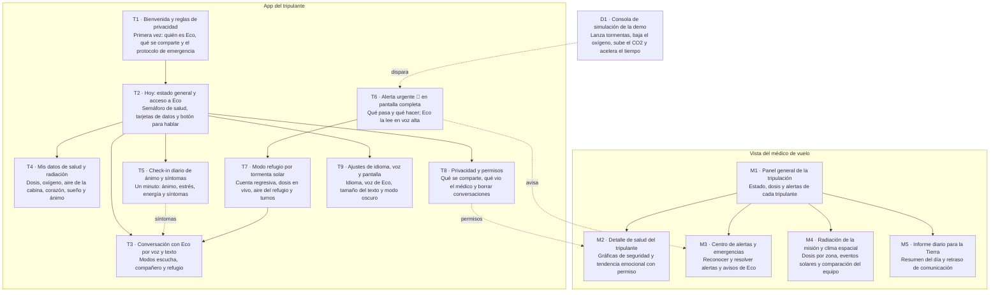

# 07 · Pantallas

> Versión en inglés: [../en/07-screens.md](../en/07-screens.md) · Ruta: [06-ruta-por-fases.md](06-ruta-por-fases.md) · Datos: [08-arquitectura.md](08-arquitectura.md)

Este documento **describe** las pantallas. No hay maquetas ni código todavía.
Hay tres grupos:
- **T:** app del tripulante.
- **M:** vista del médico de vuelo.
- **D:** consola de la demo.

Reglas para todas las pantallas:
- Funcionan en español y en inglés.
- Tienen modo oscuro.
- Tienen texto grande y botones fáciles de tocar, porque en microgravedad cuesta apuntar con precisión ⚠️.
- **Una alerta 🔴 se muestra encima de cualquier pantalla.**

## Mapa de navegación

**Nombres cortos:** dentro del texto se usan los nombres cortos (Hoy, Eco, Mis datos, Check‑in, Alerta, Refugio, Privacidad, Ajustes; Panel, Detalle, Alertas, Radiación, Informe; Consola).

---

## App del tripulante

### T1 · Bienvenida y reglas de privacidad
- **Para qué:** presentar a Eco y explicar las reglas antes de usarlo.
- **Contenido:**
  1. Elegir tripulante (en la demo) e idioma.
  2. Quién es Eco: "estoy aquí para escucharte; no soy terapeuta".
  3. **Las tres reglas de privacidad:** los datos de seguridad se comparten siempre, el ánimo solo con permiso y las conversaciones nunca.
  4. **Protocolo de emergencia**, explicado con claridad.
  5. Elegir la voz de Eco y si quiere que responda en voz alta.
  6. Permisos iniciales (todos apagados por defecto, salvo los de seguridad).
- **Acción final:** "Empezar". Queda registro de que el tripulante aceptó las reglas.

### T2 · Hoy: estado general y acceso a Eco
- **Para qué:** ver de un vistazo cómo está el tripulante y hablar con Eco.
- **Contenido:**
  - Saludo y estado general 🟢🟡🔴.
  - **Botón grande "Hablar con Eco"**, con micrófono y teclado.
  - Tarjetas resumen:
    - Dosis de hoy y dosis acumulada contra el límite.
    - SpO2.
    - Aire de la cabina (O2 y CO2).
    - Pulso.
    - Sueño de anoche.
  - Recordatorio del check‑in si falta hoy.
  - Avisos 🟡 pendientes.
- **Estados:**
  - Sin datos todavía: "esperando sensores".
  - Sensor desconectado: la tarjeta aparece en gris con un aviso.

### T3 · Conversación con Eco por voz y texto
- **Para qué:** hablar o escribir con Eco.
- **Contenido:**
  - Burbujas de conversación.
  - Indicador del modo actual: **Escucha** o **Compañero**, que se puede cambiar.
  - Botón de micrófono, con estado escuchando o procesando, y transcripción en vivo.
  - Campo de texto.
  - Botón para silenciar la voz de Eco.
  - Indicador "🔒 esta conversación solo se guarda en tu dispositivo".
- **Acciones:**
  - Cambiar entre voz y texto a mitad de la conversación.
  - Preguntar "¿cómo estoy?" (Eco responde con los datos).
  - Borrar la conversación.
- **Estados:**
  - Eco pensando.
  - Sin conexión con el servicio: aviso y opción de escribir en el diario.
  - El micrófono no tiene permiso: pasa a texto.
- **En modo refugio:** muestra un encabezado con la cuenta o el tiempo restante.

### T4 · Mis datos de salud y radiación
- **Para qué:** ver la tendencia de los datos propios.
- **Secciones (pestañas):**
  1. **Radiación:**
     - Dosis diaria (barras).
     - Dosis acumulada contra el límite de carrera (barra de progreso).
     - Proyección al final de la misión.
     - Desglose GCR, SPE y neutrones.
     - Mensaje claro y no alarmista.
  2. **Oxígeno:** SpO2 y O2 y presión de la cabina, con su línea base.
  3. **Aire:** CO2 de la cabina.
  4. **Corazón y respiración:** pulso y frecuencia respiratoria.
  5. **Sueño:** horas e interrupciones por noche.
  6. **Ánimo:** tendencia de los check‑ins. Es privada y solo la ve el tripulante.
- **Filtros:** 24 h, 7 días, 30 días y toda la misión.

### T5 · Check‑in diario de ánimo y síntomas
- **Para qué:** registrar en 1 minuto cómo se siente el tripulante.
- **Contenido:**
  - Ánimo, estrés y energía en escala de 1 a 5, con caritas.
  - Síntomas marcables: dolor de cabeza, confusión, visión, mareo y otro.
  - Nota opcional.
  - También se puede hacer hablando con Eco.
- **Después:** Eco agradece y, si hay síntomas de hipoxia, revisa la SpO2 y avisa si hace falta.

### T6 · Alerta urgente 🔴 en pantalla completa
- **Para qué:** avisar de algo que no puede esperar.
- **Contenido:** pantalla completa con:
  - Color claro.
  - Título simple: por ejemplo "Tormenta solar: ve al refugio" o "Oxígeno bajo".
  - Qué hacer en 1 a 3 pasos.
  - Botón "Entendido".
- **Comportamiento:**
  - Se muestra encima de cualquier pantalla.
  - Eco la **lee en voz alta** aunque esté en texto o silenciado.
  - Se avisa al médico automáticamente.

### T7 · Modo refugio por tormenta solar
- **Para qué:** acompañar durante una tormenta solar.
- **Contenido:**
  - Cuenta regresiva para llegar y zona asignada.
  - Dentro del refugio:
    - Dosis en vivo.
    - Dosis evitada.
    - Tiempo estimado de salida.
    - O2 y CO2 del refugio.
  - Turnos de descanso de la tripulación.
  - Botón "Hablar con Eco", que abre T3 en modo refugio.
- **Final:** pantalla "Todo despejado", con el resumen de la duración y la dosis evitada.

### T8 · Privacidad y permisos
- **Para qué:** que el tripulante controle qué se comparte.
- **Contenido:**
  - Las tres reglas, explicadas de nuevo.
  - Interruptores para cada permiso:
    - Tendencia de ánimo al médico.
    - Tendencia de sueño al médico.
    - Que Eco recuerde conversaciones pasadas.
  - Lista de **qué vio el médico y cuándo**.
  - Botones "Borrar todas mis conversaciones" (con confirmación) y "Borrar lo que Eco recuerda".
- **Regla:** al quitar un permiso, el dato deja de verse en la vista del médico al instante.

### T9 · Ajustes de idioma, voz y pantalla
- Idioma.
- Voz de Eco.
- Respuestas en voz alta (sí o no).
- Velocidad de la voz.
- Tamaño del texto.
- Modo oscuro.
- Uso de audífonos.

---

## Vista del médico de vuelo

### M1 · Panel general de la tripulación
- **Para qué:** ver a toda la tripulación de un vistazo.
- **Contenido:** una tarjeta por tripulante con:
  - Estado 🟢🟡🔴.
  - Dosis acumulada contra el límite.
  - SpO2.
  - Última alerta.
  - Tendencia de ánimo y sueño **solo si hay permiso**. Si no lo hay: "🔒 no compartido".
- Encabezado con el estado de la cabina (O2, CO2 y presión) y el clima espacial.

### M2 · Detalle de salud del tripulante
- Gráficas de los datos de seguridad, con las mismas pestañas que T4 salvo "Ánimo".
- Tendencia emocional solo con permiso.
- Historial de alertas de esa persona.
- **No muestra conversaciones**, nunca.

### M3 · Centro de alertas y emergencias
- Lista de alertas con nivel, tripulante, dato y hora.
- Filtros por nivel y por estado: activa, reconocida o resuelta.
- Botones "Reconocer" y "Resolver", con nota.
- Avisos de emergencia de Eco, que **solo indican la categoría** (por ejemplo "riesgo emocional grave") y la hora.

### M4 · Radiación de la misión y clima espacial
- Dosis por zona de la nave.
- Eventos solares pasados y activos.
- Dosis acumulada de todos los tripulantes, comparada.
- Más adelante: mapa de dosis de la nave.

### M5 · Informe diario para la Tierra
- Resumen del día para enviar a la Tierra: alertas, dosis, estado de la cabina y tendencias con permiso.
- Botón "Marcar como enviado".
- Indicador del retraso de comunicación actual.

---

## Consola de demo

### D1 · Consola de simulación de la demo
- **Solo para la presentación.** No existiría en una misión real.
- **Controles:**
  - Velocidad del tiempo (1×, 10×, 60×).
  - Elegir tripulante.
  - "Lanzar tormenta solar", que reproduce el evento histórico.
  - "Bajar O2 de la cabina".
  - "Bajar SpO2 de un tripulante".
  - "Subir CO2".
  - "Mala noche de sueño".
  - "Reiniciar demo".
- Muestra en vivo las lecturas que se están generando.

---

## Resumen de pantallas por fase

| Fase | Pantallas |
|---|---|
| 3 y 4 | T3 |
| 5 | T1, T2, T4, T5, T6, T8, T9 |
| 6 | T7 |
| 7 | M1, M2, M3, M4, M5 |
| 8 | D1 |
