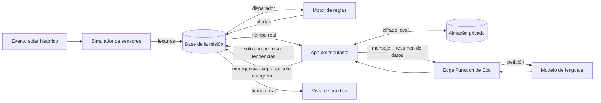
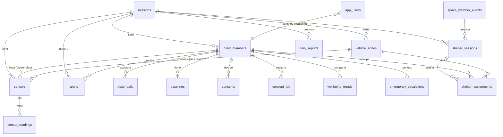

# 08 · Arquitectura y base de datos

> Versión en inglés: [../en/08-architecture.md](../en/08-architecture.md) · Ruta: [06-ruta-por-fases.md](06-ruta-por-fases.md) · Pantallas: [07-pantallas.md](07-pantallas.md)

Este documento es solo diseño; todavía no hay código ni SQL. El esquema se construye en la **fase 1**.

## 1. Idea central: dos almacenes separados
La privacidad no depende de que alguien "prometa" no mirar: **está en la estructura**.

| Almacén | Dónde vive | Qué guarda | Quién lo ve |
|---|---|---|---|
| **Base de la misión** | Servidor de la nave (en la demo, en la nube) | Sensores, dosis, alertas, refugio, permisos, tendencias compartidas e informes | El tripulante (lo suyo) y el médico (lo de seguridad, más lo que tenga permiso) |
| **Almacén privado del dispositivo** | Dispositivo personal del tripulante, cifrado | Conversaciones con Eco, diario, check‑ins completos y lo que Eco recuerda | **Solo el tripulante** |

Las conversaciones **no existen** en la base de la misión. Por eso el médico no las puede ver aunque quisiera.

---

## 2. Stack recomendado para el hackathon

| Pieza | Elección | Por qué |
|---|---|---|
| Frontend | HTML, CSS y JavaScript puro (o React si el equipo lo prefiere) | Rápido de montar y sin compilación |
| Base de la misión | **Supabase** (Postgres, Realtime, Auth y Edge Functions) | Tiempo real para las alertas, reglas de acceso (RLS) y ya lo conoces |
| Almacén privado | **IndexedDB** del navegador, cifrado con Web Crypto (AES‑GCM) | Se queda en el dispositivo |
| Eco (lenguaje) | Modelo en la nube (por ejemplo, la API de Claude), llamado desde una **Edge Function** | La clave de la API nunca llega al navegador |
| Voz | Web Speech API del navegador (voz a texto y texto a voz) ⚠️ | Gratis y suficiente para la demo |
| Simulador | Script de Node o la consola D1 con un rol especial de "simulador" | Genera lecturas creíbles y acelera el tiempo |
| Clima espacial | Archivo JSON con el evento histórico descargado de NASA DONKI o NOAA SWPC ⚠️ | La demo no depende de internet |

**En la nave real (fase 9):**
- La base de la misión correría en un servidor a bordo.
- Eco usaría un modelo local pequeño, con voz a texto y texto a voz también locales.
- No dependería de internet.

---

## 3. Componentes y flujo de datos

### Flujo 1 · Lectura → alerta
1. El simulador inserta una lectura en `sensor_readings`.
2. Un disparador de la base compara la lectura con `thresholds` y con `baselines`.
3. Si sale 🟡 o 🔴, se crea una fila en `alerts`.
4. Realtime la envía a la app del tripulante y a la del médico.
5. Si es 🔴, la app muestra T6 y Eco la lee en voz alta.

### Flujo 2 · Conversación con Eco
1. El tripulante habla o escribe. La voz se convierte en texto en el navegador.
2. La app arma un **resumen corto de datos**: estado actual, últimas alertas y dosis. Le agrega los últimos mensajes de la conversación, que salen del almacén local.
3. La Edge Function recibe el mensaje, el resumen, el modo (escucha, compañero o refugio) y el idioma. Agrega el *prompt* de sistema y llama al modelo.
4. La respuesta vuelve a la app, se guarda **solo en el almacén local** y se lee en voz alta si está activado.
5. **La Edge Function no guarda nada** y no registra el contenido.
   - En la demo, el mensaje sí pasa por el modelo en la nube; esto se explica en la presentación.
   - En la nave real todo sería local.

### Flujo 3 · Tendencias con permiso
- El dispositivo calcula un promedio diario de ánimo y sueño a partir de los check‑ins locales.
- Si hay permiso en `consents`, sube **solo ese promedio** a `wellbeing_trends`. Nunca sube las notas ni las conversaciones.
- Si se quita el permiso, se borran las filas ya compartidas y se dejan de subir.

### Flujo 4 · Protocolo de emergencia
- Eco detecta un riesgo grave y ofrece avisar.
- Si el tripulante acepta, se crea una fila en `emergency_escalations` con **solo la categoría y la hora**.
- El médico la ve en M3.

### Flujo 5 · Tormenta solar
1. La consola D1 reproduce el evento y se crea una fila en `space_weather_events`.
2. Una regla crea una alerta 🔴 para toda la tripulación y abre un `shelter_sessions`.
3. Se asignan zonas y turnos en `shelter_assignments`.
4. La dosis en vivo se calcula con las lecturas de la zona refugio.
5. Al terminar, se guarda la dosis evitada estimada.

---

## 4. Base de la misión (Postgres)

> **Actualización:** el diseño final, revisado pantalla por pantalla, está en [09-diagrama-bd.md](09-diagrama-bd.md). Agrega 8 tablas y 3 vistas, y cambia los turnos del refugio a la tabla `shelter_shifts`. Si algo de esta sección no coincide, **manda el documento 09**.

### Tipos (enums)
- `user_role`: `crew`, `surgeon`, `simulator`, `admin`
- `metric`:
  - Radiación: `dose_rate_usv_h`, `neutron_dose_rate_usv_h`
  - Signos del tripulante: `spo2_pct`, `heart_rate_bpm`, `resp_rate_bpm`, `sleep_minutes`, `sleep_interruptions`
  - Cabina: `cabin_o2_pct`, `cabin_pressure_psia`, `cabin_co2_mmhg`, `cabin_temp_c`
- `alert_level`: `normal`, `attention`, `urgent`
- `alert_status`: `active`, `acknowledged`, `resolved`
- `consent_scope`: `mood_trend`, `sleep_trend`
- `sensor_kind`: `wearable`, `personal_dosimeter`, `area_dosimeter`, `cabin_env`
- `escalation_category`: `self_harm_risk`, `acute_panic`, `other_serious`

### Tablas

**Misión y personas**

| Tabla | Columnas principales | Notas |
|---|---|---|
| `missions` | `id`, `name`, `destination`, `start_date`, `end_date_planned`, `comm_delay_s` | `comm_delay_s` alimenta el indicador de retraso |
| `crew_members` | `id`, `mission_id`, `display_name`, `role_title`, `language` (`es`/`en`), `prior_career_dose_msv`, `career_limit_msv` (600 por defecto ⚠️) | Dosis de misiones anteriores, para el riesgo de carrera |
| `app_users` | `id` (= usuario de Auth), `role` (`user_role`), `crew_member_id` (nulo si no es tripulante), `mission_id` | Une la cuenta con la persona y su rol |
| `rules_acceptance` | `crew_member_id`, `accepted_at`, `rules_version` | Registro de que aceptó las reglas en T1 |

**Nave y sensores**

| Tabla | Columnas principales | Notas |
|---|---|---|
| `vehicle_zones` | `id`, `mission_id`, `name`, `shielding_factor`, `is_shelter`, `capacity` | El refugio es una zona con `is_shelter = true` |
| `sensors` | `id`, `mission_id`, `kind` (`sensor_kind`), `zone_id` (nulo si es personal), `crew_member_id` (nulo si es de área), `active` | Personal o de área |
| `sensor_readings` | `id`, `sensor_id`, `crew_member_id` (nulo en cabina), `zone_id`, `metric`, `value`, `recorded_at` | Tabla grande de series de tiempo. Índice por (`crew_member_id`, `metric`, `recorded_at`) y por (`zone_id`, `metric`, `recorded_at`) |

**Radiación**

| Tabla | Columnas principales | Notas |
|---|---|---|
| `dose_daily` | `crew_member_id`, `day`, `total_msv`, `gcr_msv`, `spe_msv`, `neutron_msv` | Clave (`crew_member_id`, `day`). Se recalcula con cada lectura de dosis |
| Vista `dose_career` | `crew_member_id`, `mission_dose_msv`, `career_dose_msv`, `career_limit_msv`, `pct_of_limit`, `projected_end_msv` | Calculada a partir de `dose_daily` y `crew_members` |
| `space_weather_events` | `id`, `source` (DONKI/SWPC), `external_id`, `event_type`, `s_scale`, `starts_at`, `peak_at`, `ends_at`, `raw` (json) | El evento histórico de la demo |
| `shelter_sessions` | `id`, `mission_id`, `event_id`, `zone_id`, `started_at`, `ended_at`, `dose_avoided_est_msv` | Una por tormenta |
| `shelter_assignments` | `session_id`, `crew_member_id`, `zone_id`, `rest_shift_start`, `rest_shift_end`, `arrived_at` | Zona y turnos de cada persona |

**Reglas y alertas**

| Tabla | Columnas principales | Notas |
|---|---|---|
| `thresholds` | `metric`, `level`, `min_value`, `max_value`, `source_url`, `verified` | Un valor marcado ⚠️ queda con `verified = false` hasta comprobarlo en la fase 0 |
| `baselines` | `crew_member_id`, `metric`, `mean`, `stddev`, `samples`, `updated_at` | Línea base personal |
| `alerts` | `id`, `mission_id`, `crew_member_id` (nulo si es de toda la nave), `level`, `status`, `kind` (p. ej. `solar_storm`, `low_spo2`, `high_co2`), `metric`, `value`, `message_es`, `message_en`, `created_at`, `acknowledged_at`, `acknowledged_by`, `resolved_at`, `note` | El mensaje va en los dos idiomas |

**Privacidad y médico**

| Tabla | Columnas principales | Notas |
|---|---|---|
| `consents` | `crew_member_id`, `scope` (`consent_scope`), `granted`, `updated_at` | Clave (`crew_member_id`, `scope`) |
| `consent_log` | `id`, `crew_member_id`, `scope`, `granted`, `changed_at` | Historial de cambios, que nunca se borra |
| `wellbeing_trends` | `crew_member_id`, `day`, `mood_avg`, `stress_avg`, `sleep_quality_avg` | **Solo** promedios diarios, y solo si hay permiso |
| `surgeon_access_log` | `id`, `surgeon_user_id`, `crew_member_id`, `resource`, `viewed_at` | Alimenta "qué vio el médico y cuándo" en T8 |
| `emergency_escalations` | `id`, `crew_member_id`, `category`, `created_at`, `acknowledged_at`, `acknowledged_by` | **Sin** texto de conversación |
| `daily_reports` | `id`, `mission_id`, `day`, `summary` (json), `created_at`, `sent_to_earth_at` | Informe de M5 |

### Relaciones

### Reglas de acceso (RLS)

| Tabla | Tripulante | Médico | Simulador |
|---|---|---|---|
| `sensor_readings`, `dose_daily`, `baselines` | Lee lo suyo y la cabina | Lee todo | Inserta |
| `alerts` | Lee las suyas y las de toda la nave; las reconoce | Lee todas; reconoce y resuelve | Inserta (por reglas) |
| `consents`, `consent_log` | Lee y cambia **solo** lo suyo | Lee | — |
| `wellbeing_trends` | Inserta y borra lo suyo | Lee **solo si** el permiso de ese tripulante está activo (la política cruza con `consents`) | — |
| `emergency_escalations` | Inserta la suya | Lee y reconoce | — |
| `surgeon_access_log` | Lee lo que se vio de él | Inserta (automático al ver) | — |
| `daily_reports` | — | Crea y marca como enviado | — |
| `missions`, `vehicle_zones`, `thresholds` | Lee | Lee | Lee |

**Protecciones adicionales:**
- Al quitar un permiso, un disparador en `consents` borra las filas ya compartidas de `wellbeing_trends`.
- Ninguna tabla tiene columnas de texto libre del tripulante, salvo la `note` del médico en `alerts`.
- La clave de servicio del simulador solo existe en la consola de demo, nunca en la app del tripulante.

### Rendimiento
- `sensor_readings` crece rápido: en la demo hay que **limpiar o agregar** las lecturas de más de 7 días simulados, guardando promedios por hora.
- Realtime solo se suscribe a `alerts`, `shelter_sessions` y a las lecturas del tripulante actual.

---

## 5. Almacén privado del dispositivo (IndexedDB, cifrado)

| Almacén | Campos | Notas |
|---|---|---|
| `conversations` | `id`, `started_at`, `mode` (listen/companion/shelter), `language` | |
| `messages` | `id`, `conversation_id`, `role` (crew/eco), `text`, `input` (voice/text), `created_at` | La voz se guarda solo como texto transcrito, no como audio |
| `journal_entries` | `id`, `text`, `created_at` | Diario privado |
| `checkins` | `id`, `day`, `mood`, `stress`, `energy`, `symptoms[]`, `note`, `created_at` | Las notas nunca salen del dispositivo |
| `memory_facts` | `id`, `fact`, `source_conversation_id`, `created_at` | Lo que Eco recuerda; solo existe si el tripulante dio permiso en T8 |
| `settings` | `language`, `voice`, `speak_replies`, `voice_rate`, `text_size`, `theme` | |

**Cifrado:**
- Una clave por tripulante, derivada de su PIN o contraseña local (PBKDF2 → AES‑GCM).
- Si se borra la clave, todo el almacén queda ilegible.

**Borrado:** los botones de T8 eliminan `conversations`, `messages` y `memory_facts`.

---

## 6. Seguridad y privacidad (resumen)
- La clave de la API del modelo vive solo en la Edge Function.
- La Edge Function no registra mensajes: sin logs de contenido y sin guardar nada.
- Las conversaciones solo existen en el dispositivo, cifradas.
- El médico ve los datos de seguridad siempre; lo emocional solo con permiso, y queda registro de cada vista.
- El protocolo de emergencia comparte solo la categoría y la hora.
- **Aviso en la demo:** "En la misión real, Eco funciona sin salir de la nave."

## 7. Decisiones abiertas
- ¿HTML y JS puro o React?
- ¿PIN local para cifrar, o una contraseña?
- ¿Qué evento solar histórico se reproduce?
