# 09 · Diagrama de la base de datos a partir de las pantallas

> Versión en inglés: [../en/09-database-diagram.md](../en/09-database-diagram.md) · Pantallas: [07-pantallas.md](07-pantallas.md) · Arquitectura: [08-arquitectura.md](08-arquitectura.md)

Recorrí las 15 pantallas, una por una, y anoté qué datos lee y qué datos escribe cada una. Con eso:
- Se completó el diseño del documento 08.
- Se agregaron las tablas que faltaban.
- Quedó el **diagrama final** para crear la base de datos en la fase 1.

> **Implementado:** el SQL está en [supabase/schema.sql](../../supabase/schema.sql) y los datos de prueba en [supabase/seed_demo.sql](../../supabase/seed_demo.sql). Al escribirlo se agregaron tres columnas:
> - `alerts.zone_id`: las alertas de cabina necesitan saber su zona.
> - `alert_types.metric`: une cada dato con su tipo de alerta.
> - `space_weather_events.mission_id`: la misión que reproduce el evento.
>
> También se agregaron funciones (RPC) para que la app no edite tablas directamente: `acknowledge_alert`, `mark_alert_spoken`, `mark_shelter_arrival`, `set_my_language`, `resolve_alert` y `close_shelter_session`. Los síntomas físicos quedaron **compartidos siempre con el médico, sin nota**.

Recordatorio de la regla principal:
- **Conversaciones, diario, notas y ajustes personales** viven en el **almacén privado del dispositivo**, no en esta base.
- Esta base es la **base de la misión** (Postgres en Supabase).

---

## 1. Qué necesita cada pantalla

| Pantalla | Lee | Escribe | Almacén privado |
|---|---|---|---|
| **T1** Bienvenida y reglas de privacidad | `crew_members`, `missions` | `rules_acceptance`, `consents`, `consent_log` | `settings` (voz e idioma) |
| **T2** Hoy: estado general y acceso a Eco | Vistas `crew_status`, `latest_readings`, `cabin_status`, `dose_career`; `alerts` 🟡 activas; `sensors.last_seen_at` | — | `checkins` (¿falta el de hoy?) |
| **T3** Conversación con Eco | Vistas `latest_readings`, `dose_career`; `alerts` activas; `shelter_sessions` activa | `emergency_escalations` (solo si el tripulante acepta) | `conversations`, `messages`, `memory_facts` |
| **T4** Mis datos de salud y radiación | `sensor_readings` (24 h), `sensor_readings_hourly` (7 días, 30 días y misión), `baselines`, `dose_daily`, vista `dose_career`, `thresholds` | — | `checkins` (pestaña Ánimo) |
| **T5** Check‑in diario | — | `symptom_reports` (solo síntomas físicos, sin nota) y `wellbeing_trends` (promedio del día, solo con permiso) | `checkins` completo, con nota |
| **T6** Alerta urgente 🔴 | `alerts`, `alert_types` (título y pasos en los dos idiomas) | `alert_acknowledgements`, `alerts.spoken_at` | — |
| **T7** Modo refugio | `shelter_sessions`, `shelter_assignments`, `shelter_shifts`, `vehicle_zones`, `sensor_readings` del refugio, `space_weather_events` | `shelter_assignments.arrived_at` | — |
| **T8** Privacidad y permisos | `consents`, `consent_log`, `surgeon_access_log` | `consents`, `consent_log`; borrado de `wellbeing_trends` | Borrado de `conversations`, `messages` y `memory_facts` |
| **T9** Ajustes | — | `crew_members.language` (para los mensajes de alerta) | `settings` |
| **M1** Panel general de la tripulación | Vistas `crew_status`, `dose_career`, `cabin_status`; `wellbeing_trends` (con permiso); `space_weather_events` activos | `surgeon_access_log` | — |
| **M2** Detalle de salud del tripulante | `sensor_readings`, `sensor_readings_hourly`, `baselines`, `dose_daily`, `alerts`, `symptom_reports`, `wellbeing_trends` (con permiso) | `surgeon_access_log` | — |
| **M3** Centro de alertas y emergencias | `alerts`, `alert_types`, `alert_acknowledgements`, `emergency_escalations` | `alerts` (reconocer, resolver y nota), `emergency_escalations` (reconocer) | — |
| **M4** Radiación de la misión y clima espacial | `zone_dose_daily`, `vehicle_zones`, `space_weather_events`, vista `dose_career` | — | — |
| **M5** Informe diario para la Tierra | Todo lo anterior, resumido; `missions.comm_delay_s` | `daily_reports` | — |
| **D1** Consola de simulación | `simulation_state`, `crew_members`, `sensors` | `simulation_state`, `simulation_events`, `sensor_readings`, `space_weather_events` | — |

---

## 2. Qué cambió respecto al documento 08

| Cambio | Por qué (pantalla) |
|---|---|
| **Nueva:** `alert_types` | T6 necesita un título y 1 a 3 pasos por tipo de alerta, en los dos idiomas |
| **Nueva:** `alert_acknowledgements` | Una alerta de toda la nave la reconoce **cada** tripulante por separado (T6), además del médico (M3) |
| **Nueva:** `shelter_shifts` | T7 muestra varios turnos por persona; reemplaza las columnas de turno de `shelter_assignments` |
| **Nueva:** `symptom_reports` | T5 y M2: los síntomas físicos de hipoxia son datos de seguridad. ⚠️ Decisión tuya: ¿se comparten siempre o solo con permiso? |
| **Nueva:** `sensor_readings_hourly` | T4 y M2 muestran 30 días y la misión completa; leer cada lectura sería muy lento |
| **Nueva:** `zone_dose_daily` | M4 muestra la dosis por zona de la nave |
| **Nuevas:** `simulation_state`, `simulation_events` | D1 controla el reloj simulado, la velocidad y el reinicio de la demo |
| **Nuevas vistas:** `latest_readings`, `crew_status`, `cabin_status` | T2 y M1 muestran "lo último" y el semáforo sin cálculos en el navegador |
| **Columnas nuevas:** `sensors.last_seen_at`, `alerts.alert_type_id`, `alerts.resolved_by`, `alerts.spoken_at`, `alerts.shelter_session_id`, `shelter_sessions.expected_end_at`, `emergency_escalations.resolved_at`, `crew_members.avatar_color` | Estado "sensor desconectado" (T2), pasos de la alerta (T6), tiempo de salida (T7) e identificación visual (M1) |

---

## 3. Diagrama completo

Tipos: `uuid`, `text`, `int`, `numeric`, `bool`, `date`, `timestamptz`, `jsonb`. Las enumeraciones se detallan en la sección 5.
Marcas: **PK** = clave primaria, **FK** = clave foránea, **UK** = valor único.

```mermaid
erDiagram
  missions {
    uuid id PK
    text name
    text destination
    date start_date
    date end_date_planned
    int comm_delay_s
    timestamptz created_at
  }
  crew_members {
    uuid id PK
    uuid mission_id FK
    text display_name
    text role_title
    text language
    text avatar_color
    numeric prior_career_dose_msv
    numeric career_limit_msv
    timestamptz created_at
  }
  app_users {
    uuid id PK "usuario de Auth"
    user_role role
    uuid mission_id FK
    uuid crew_member_id FK "nulo si no es tripulante"
    text display_name
  }
  rules_acceptance {
    uuid crew_member_id PK,FK
    text rules_version PK
    timestamptz accepted_at
  }
  vehicle_zones {
    uuid id PK
    uuid mission_id FK
    text name
    numeric shielding_factor
    bool is_shelter
    int capacity
  }
  sensors {
    uuid id PK
    uuid mission_id FK
    sensor_kind kind
    uuid zone_id FK "nulo si es personal"
    uuid crew_member_id FK "nulo si es de área"
    bool active
    timestamptz last_seen_at
  }
  sensor_readings {
    bigint id PK
    uuid sensor_id FK
    uuid crew_member_id FK "nulo en cabina"
    uuid zone_id FK
    metric metric
    numeric value
    timestamptz recorded_at "hora simulada"
  }
  sensor_readings_hourly {
    uuid sensor_id PK,FK
    metric metric PK
    timestamptz hour PK
    uuid crew_member_id FK
    uuid zone_id FK
    numeric avg_value
    numeric min_value
    numeric max_value
    int samples
  }
  baselines {
    uuid crew_member_id PK,FK
    metric metric PK
    numeric mean
    numeric stddev
    int samples
    timestamptz updated_at
  }
  thresholds {
    metric metric PK
    alert_level level PK
    numeric min_value
    numeric max_value
    text source_url
    bool verified
  }
  dose_daily {
    uuid crew_member_id PK,FK
    date day PK
    numeric total_msv
    numeric gcr_msv
    numeric spe_msv
    numeric neutron_msv
  }
  zone_dose_daily {
    uuid zone_id PK,FK
    date day PK
    numeric total_msv
    numeric neutron_msv
  }
  alert_types {
    text code PK "low_spo2, high_co2, solar_storm..."
    alert_level default_level
    text title_es
    text title_en
    jsonb steps_es
    jsonb steps_en
  }
  alerts {
    uuid id PK
    uuid mission_id FK
    uuid crew_member_id FK "nulo si es de toda la nave"
    text alert_type_id FK
    uuid shelter_session_id FK
    alert_level level
    alert_status status
    metric metric
    numeric value
    text message_es
    text message_en
    timestamptz created_at
    timestamptz spoken_at
    timestamptz acknowledged_at
    uuid acknowledged_by FK
    timestamptz resolved_at
    uuid resolved_by FK
    text note "solo el médico"
  }
  alert_acknowledgements {
    uuid alert_id PK,FK
    uuid user_id PK,FK
    timestamptz acknowledged_at
  }
  symptom_reports {
    uuid id PK
    uuid crew_member_id FK
    symptom symptom
    timestamptz reported_at
  }
  emergency_escalations {
    uuid id PK
    uuid crew_member_id FK
    escalation_category category
    timestamptz created_at
    timestamptz acknowledged_at
    uuid acknowledged_by FK
    timestamptz resolved_at
  }
  space_weather_events {
    uuid id PK
    text source
    text external_id UK
    text event_type
    int s_scale
    timestamptz starts_at
    timestamptz peak_at
    timestamptz ends_at
    jsonb raw
  }
  shelter_sessions {
    uuid id PK
    uuid mission_id FK
    uuid event_id FK
    uuid zone_id FK
    timestamptz started_at
    timestamptz expected_end_at
    timestamptz ended_at
    numeric dose_avoided_est_msv
  }
  shelter_assignments {
    uuid session_id PK,FK
    uuid crew_member_id PK,FK
    uuid zone_id FK
    timestamptz arrived_at
  }
  shelter_shifts {
    uuid id PK
    uuid session_id FK
    uuid crew_member_id FK
    shift_kind kind
    timestamptz starts_at
    timestamptz ends_at
  }
  consents {
    uuid crew_member_id PK,FK
    consent_scope scope PK
    bool granted
    timestamptz updated_at
  }
  consent_log {
    uuid id PK
    uuid crew_member_id FK
    consent_scope scope
    bool granted
    timestamptz changed_at
  }
  wellbeing_trends {
    uuid crew_member_id PK,FK
    date day PK
    numeric mood_avg
    numeric stress_avg
    numeric energy_avg
    numeric sleep_quality_avg
  }
  surgeon_access_log {
    uuid id PK
    uuid surgeon_user_id FK
    uuid crew_member_id FK
    text resource
    timestamptz viewed_at
  }
  daily_reports {
    uuid id PK
    uuid mission_id FK
    date day UK
    jsonb summary
    uuid created_by FK
    timestamptz created_at
    timestamptz sent_to_earth_at
  }
  simulation_state {
    uuid mission_id PK,FK
    timestamptz sim_clock
    int time_speed
    bool running
    timestamptz updated_at
  }
  simulation_events {
    uuid id PK
    uuid mission_id FK
    text kind "solar_storm, lower_o2, raise_co2..."
    jsonb params
    uuid triggered_by FK
    timestamptz triggered_at
  }

  missions ||--o{ crew_members : tiene
  missions ||--o{ app_users : agrupa
  missions ||--o{ vehicle_zones : tiene
  missions ||--o{ sensors : tiene
  missions ||--o{ alerts : genera
  missions ||--o{ shelter_sessions : tiene
  missions ||--o{ daily_reports : produce
  missions ||--|| simulation_state : controla
  missions ||--o{ simulation_events : registra
  crew_members |o--o| app_users : "inicia sesión como"
  crew_members ||--o{ rules_acceptance : acepta
  crew_members ||--o{ sensors : "lleva (personales)"
  vehicle_zones ||--o{ sensors : "contiene (de área)"
  sensors ||--o{ sensor_readings : mide
  sensors ||--o{ sensor_readings_hourly : resume
  crew_members ||--o{ baselines : tiene
  crew_members ||--o{ dose_daily : acumula
  vehicle_zones ||--o{ zone_dose_daily : acumula
  alert_types ||--o{ alerts : define
  crew_members ||--o{ alerts : recibe
  alerts ||--o{ alert_acknowledgements : "reconocida por"
  app_users ||--o{ alert_acknowledgements : reconoce
  crew_members ||--o{ symptom_reports : reporta
  crew_members ||--o{ emergency_escalations : genera
  space_weather_events ||--o{ shelter_sessions : provoca
  shelter_sessions ||--o{ alerts : origina
  vehicle_zones ||--o{ shelter_sessions : "sirve de refugio"
  shelter_sessions ||--o{ shelter_assignments : asigna
  crew_members ||--o{ shelter_assignments : participa
  shelter_sessions ||--o{ shelter_shifts : organiza
  crew_members ||--o{ shelter_shifts : cubre
  crew_members ||--o{ consents : decide
  crew_members ||--o{ consent_log : registra
  crew_members ||--o{ wellbeing_trends : comparte
  crew_members ||--o{ surgeon_access_log : "es consultado"
  app_users ||--o{ surgeon_access_log : consulta
  app_users ||--o{ daily_reports : crea
  app_users ||--o{ simulation_events : dispara
```

---

## 4. Vistas

| Vista | Columnas | La usan |
|---|---|---|
| `latest_readings` | `crew_member_id`, `zone_id`, `metric`, `value`, `recorded_at`, `level` (comparado con `thresholds`) | T2, T3, M1 |
| `crew_status` | `crew_member_id`, `display_name`, `overall_level` (el peor nivel de sus alertas activas), `active_alerts`, `last_reading_at` | T2, M1 |
| `cabin_status` | `zone_id`, `cabin_o2_pct`, `cabin_pressure_psia`, `cabin_co2_mmhg`, `cabin_temp_c`, `level` | T2, M1, T7 |
| `dose_career` | `crew_member_id`, `mission_dose_msv`, `career_dose_msv`, `career_limit_msv`, `pct_of_limit`, `projected_end_msv` | T2, T4, M1, M4 |

---

## 5. Enumeraciones

| Enum | Valores |
|---|---|
| `user_role` | `crew`, `surgeon`, `simulator`, `admin` |
| `sensor_kind` | `wearable`, `personal_dosimeter`, `area_dosimeter`, `cabin_env` |
| `metric` | `dose_rate_usv_h`, `neutron_dose_rate_usv_h`, `spo2_pct`, `heart_rate_bpm`, `resp_rate_bpm`, `sleep_minutes`, `sleep_interruptions`, `cabin_o2_pct`, `cabin_pressure_psia`, `cabin_co2_mmhg`, `cabin_temp_c` |
| `alert_level` | `normal`, `attention`, `urgent` |
| `alert_status` | `active`, `acknowledged`, `resolved` |
| `symptom` | `headache`, `confusion`, `vision`, `dizziness`, `shortness_of_breath`, `other` |
| `escalation_category` | `self_harm_risk`, `acute_panic`, `other_serious` |
| `consent_scope` | `mood_trend`, `sleep_trend` |
| `shift_kind` | `rest`, `watch` |

---

## 6. Disparadores (lógica dentro de la base)

| Disparador | En | Qué hace |
|---|---|---|
| `evaluar_lectura` | Al insertar en `sensor_readings` | Actualiza `sensors.last_seen_at`. Compara la lectura con `thresholds` y `baselines` y, si sale 🟡 o 🔴, crea una fila en `alerts` (sin repetir una alerta que siga activa). Si es dosis, suma en `dose_daily` y en `zone_dose_daily`. |
| `iniciar_refugio` | Al insertar en `space_weather_events` con `s_scale` alto | Crea `shelter_sessions`, una alerta 🔴 de toda la nave y una fila de `shelter_assignments` por tripulante. |
| `limpiar_tendencias` | Al cambiar `consents` a `granted = false` | Borra las filas de `wellbeing_trends` de ese tripulante y escribe en `consent_log`. |
| `registrar_permiso` | Al insertar o cambiar `consents` | Escribe en `consent_log`. |
| `agregar_por_hora` | Tarea periódica (o al avanzar el reloj simulado) | Resume `sensor_readings` en `sensor_readings_hourly` y borra las lecturas de más de 7 días simulados. |
| `actualizar_linea_base` | Tarea periódica | Recalcula `baselines` con los últimos días. |

---

## 7. Orden para crear la base (fase 1)
1. **Enumeraciones** (sección 5).
2. **Catálogos:** `missions`, `alert_types`, `thresholds`.
3. **Personas:** `crew_members`, `app_users`, `rules_acceptance`.
4. **Nave:** `vehicle_zones`, `sensors`.
5. **Datos:** `sensor_readings`, `sensor_readings_hourly`, `baselines`, `dose_daily`, `zone_dose_daily`.
6. **Clima espacial y refugio:** `space_weather_events`, `shelter_sessions`, `shelter_assignments`, `shelter_shifts`.
7. **Alertas:** `alerts`, `alert_acknowledgements`, `symptom_reports`, `emergency_escalations`.
8. **Privacidad:** `consents`, `consent_log`, `wellbeing_trends`, `surgeon_access_log`.
9. **Informes y demo:** `daily_reports`, `simulation_state`, `simulation_events`.
10. **Vistas** (sección 4).
11. **Disparadores** (sección 6).
12. **Reglas de acceso (RLS):** ver la tabla del documento 08, más las de las tablas nuevas:
    - `alert_acknowledgements`: cada usuario inserta la suya y el médico lee todas.
    - `symptom_reports`: el tripulante inserta y lee las suyas; el médico lee todas, o solo con permiso según tu decisión.
    - `simulation_state` y `simulation_events`: solo el rol `simulator`.
    - `zone_dose_daily` y `alert_types`: todos leen.
13. **Datos de prueba:** 1 misión, 4 tripulantes, 1 médico, zonas (incluido el refugio), sensores, tipos de alerta y umbrales con su fuente.

**Total:** 28 tablas, 4 vistas, 9 enumeraciones y 6 disparadores.

---

## 8. Decisiones antes de crearla
- **Síntomas físicos (`symptom_reports`):** ¿se comparten siempre con el médico, como los datos de seguridad, o solo con permiso? Mi recomendación es siempre, pero sin la nota.
- **Reloj simulado:** todas las horas (`recorded_at`, etc.) usan la hora simulada de `simulation_state.sim_clock`. Así la demo puede avanzar días en minutos.
- **Identificadores:** `uuid` en todo, salvo en `sensor_readings`, que usa `bigint` porque es la tabla más grande.
